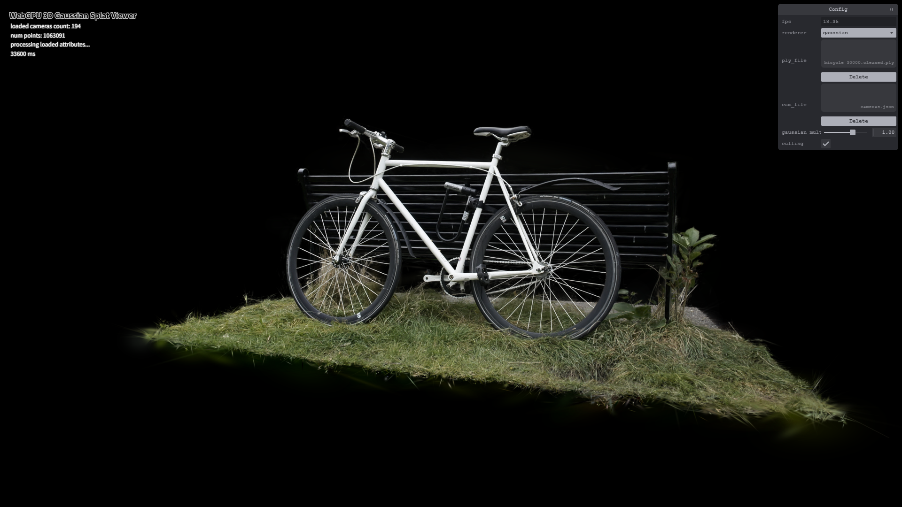
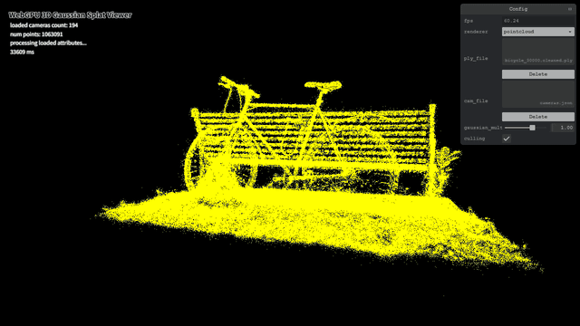
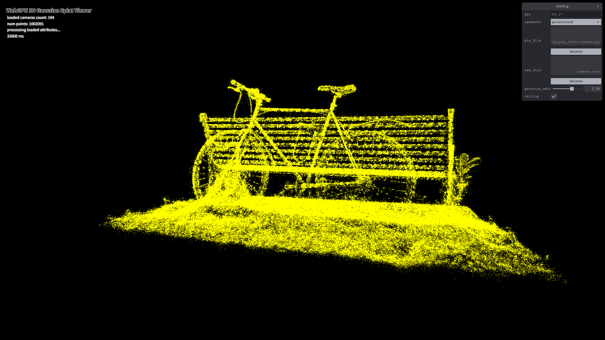
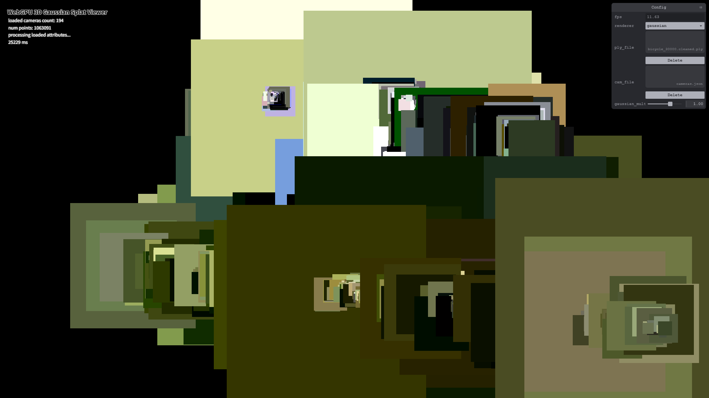
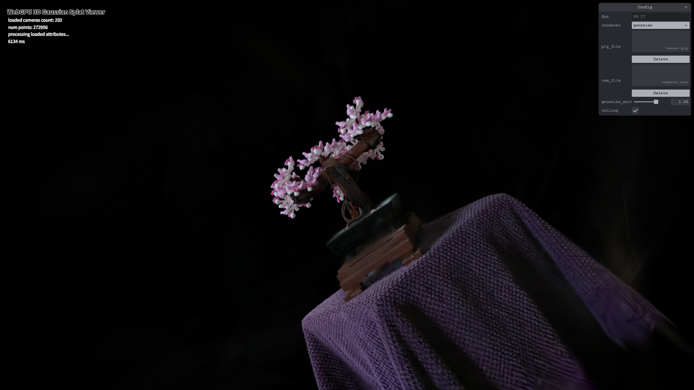

# Project5-WebGPU-Gaussian-Splat-Viewer

**University of Pennsylvania, CIS 565: GPU Programming and Architecture, Project 5**

* Chen Cheng
  * [LinkedIn](https://www.linkedin.com/in/chen-andrew-cheng-34a133229/), [GitHub](https://github.com/ischencheng)
* Tested on: **Google Chrome 155** on Windows 11, i5-12500H @ 2.50GHz 16GB, NVIDIA GeForce RTX 2050 4GB (personal laptop)

### Live Demo

### Demo Video/GIF

### Description

This project is a 3D Gaussian Splatting viewer in WebGPU. A scene is a list of 0.3 to 1 million 3D gaussians, and each gaussian has a position, a rotation, a scale, an opacity and spherical harmonics coefficients for its color. Every frame, a compute shader projects each gaussian to a 2D splat on the screen, a radix sort puts the splats in back to front order, and a render pass draws every splat as a quad and blends them together.

In the GUI I can switch between the point cloud and the gaussian renderer, change the gaussian size multiplier, and turn view frustum culling on and off. To use the live demo, load a `.ply` scene and its `cameras.json`, then drag to look around (right drag to pan, scroll to move forward and back) and press 0-9 to jump to the camera presets.

### Point Cloud

The point cloud renderer draws every gaussian as one yellow point. I only had to add the MVP transform in `point_cloud.wgsl`: the position is multiplied by the view matrix and then by the projection matrix from the camera uniform. This is the same view as the live demo picture above.

### Preprocessing

The preprocess compute shader (`preprocess.wgsl`) runs one thread per gaussian. First it moves the center to NDC and skips the gaussian if it is outside a box 1.2 times the size of the screen, so splats that are only partly on the screen are still drawn. Then it builds the 3D covariance from the rotation quaternion $R$ and the scale $S$, and projects it to a 2D covariance on the screen with the Jacobian $J$ of the perspective projection and the rotation part $W$ of the view matrix:

$$\Sigma = R S S^T R^T, \quad \Sigma' = J W \Sigma W^T J^T$$

The scale is stored in log space and the opacity before a sigmoid, so I take `exp` of the scale (times the gaussian multiplier from the GUI) and the sigmoid of the opacity. From the 2D covariance I get the conic, which is its inverse, and the radius of the splat, which is 3 times the square root of the bigger eigenvalue. The color comes from the spherical harmonics, evaluated in the direction from the camera to the gaussian. All of this is packed into a splat buffer, mostly as f16 with `pack2x16float`. The picture above is from before I added the blending: every splat is an opaque square as big as its radius, with its color.

### Sorting and Rendering

Since the splats are semi-transparent, they have to be drawn from back to front. Each visible gaussian uses `atomicAdd` on the key count to get a slot in the sort buffers, and writes its index and its depth key there. The key is the view space depth with all bits flipped: for positive floats the bits are in the same order as the values, and the radix sort is ascending, so the farthest splat comes first. The same key count is copied into an indirect draw buffer, so the render pass only draws the splats that are left after culling.

The vertex shader makes a quad of 6 vertices for each splat in sorted order, as big as its radius. The fragment shader takes the pixel offset $d$ from the splat center and uses the conic to get the opacity, which goes down exponentially away from the center: $\alpha = o \cdot e^{-\frac{1}{2} d^T {\Sigma'}^{-1} d}$, where $o$ is the opacity of the gaussian. Pixels with almost no alpha are discarded, and the rest are blended with premultiplied alpha.

### Credits

- [Vite](https://vitejs.dev/)
- [tweakpane](https://tweakpane.github.io/docs//v3/monitor-bindings/)
- [stats.js](https://github.com/mrdoob/stats.js)
- [wgpu-matrix](https://github.com/greggman/wgpu-matrix)
- Special Thanks to: Shrek Shao (Google WebGPU team) & [Differential Guassian Renderer](https://github.com/graphdeco-inria/diff-gaussian-rasterization)
