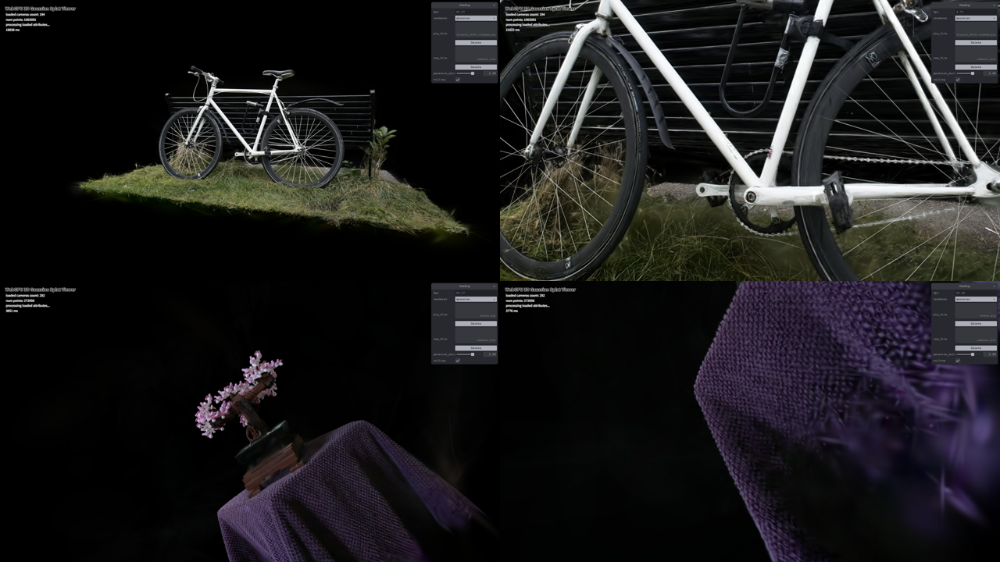
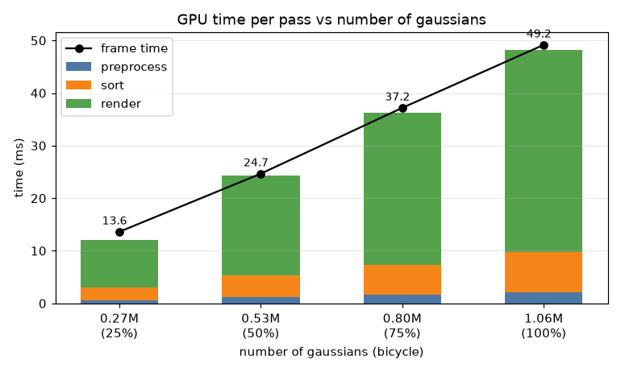

# Project5-WebGPU-Gaussian-Splat-Viewer

**University of Pennsylvania, CIS 565: GPU Programming and Architecture, Project 5**

* Chen Cheng
  * [LinkedIn](https://www.linkedin.com/in/chen-andrew-cheng-34a133229/), [GitHub](https://github.com/ischencheng)
* Tested on: **Google Chrome 155** on Windows 11, i5-12500H @ 2.50GHz 16GB, NVIDIA GeForce RTX 2050 4GB (personal laptop)

### Live Demo

### Demo Video/GIF

### Description

This project is a 3D Gaussian Splatting viewer in WebGPU. A scene is a list of 0.3 to 1 million 3D gaussians, and each gaussian has a position, a rotation, a scale, an opacity and spherical harmonics coefficients for its color. Every frame, a compute shader projects each gaussian to a 2D splat on the screen, a radix sort puts the splats in back to front order, and a render pass draws every splat as a quad and blends them together.

In the GUI I can switch between the point cloud and the gaussian renderer, change the gaussian size multiplier, and turn view frustum culling on and off. To use the live demo, load a `.ply` scene and its `cameras.json`, then drag to look around (right drag to pan, scroll to move forward and back) and press 0-9 to jump to the camera presets.

### Point Cloud

The point cloud renderer draws every gaussian as one yellow point. I only had to add the MVP transform in `point_cloud.wgsl`: the position is multiplied by the view matrix and then by the projection matrix from the camera uniform. This is the same view as the live demo picture above.

### Preprocessing

The preprocess compute shader (`preprocess.wgsl`) runs one thread per gaussian. First it moves the center to NDC and skips the gaussian if it is outside a box 1.2 times the size of the screen, so splats that are only partly on the screen are still drawn. Then it builds the 3D covariance from the rotation quaternion $R$ and the scale $S$, and projects it to a 2D covariance on the screen with the Jacobian $J$ of the perspective projection and the rotation part $W$ of the view matrix:

$$\Sigma = R S S^T R^T, \quad \Sigma' = J W \Sigma W^T J^T$$

The scale is stored in log space and the opacity before a sigmoid, so I take `exp` of the scale (times the gaussian multiplier from the GUI) and the sigmoid of the opacity. From the 2D covariance I get the conic, which is its inverse, and the radius of the splat, which is 3 times the square root of the bigger eigenvalue. The color comes from the spherical harmonics, evaluated in the direction from the camera to the gaussian. All of this is packed into a splat buffer, mostly as f16 with `pack2x16float`. The picture above is from before I added the blending: every splat is an opaque square as big as its radius, with its color.

### Sorting and Rendering

Since the splats are semi-transparent, they have to be drawn from back to front. Each visible gaussian uses `atomicAdd` on the key count to get a slot in the sort buffers, and writes its index and its depth key there. The key is the view space depth with all bits flipped: for positive floats the bits are in the same order as the values, and the radix sort is ascending, so the farthest splat comes first. The same key count is copied into an indirect draw buffer, so the render pass only draws the splats that are left after culling.

The vertex shader makes a quad of 6 vertices for each splat in sorted order, as big as its radius. The fragment shader takes the pixel offset $d$ from the splat center and uses the conic to get the opacity, which goes down exponentially away from the center: $\alpha = o \cdot e^{-\frac{1}{2} d^T {\Sigma'}^{-1} d}$, where $o$ is the opacity of the gaussian. Pixels with almost no alpha are discarded, and the rest are blended with premultiplied alpha.

### Performance Analysis

I measured everything in headless Chrome at 1920x1080 with vsync off. The frame time is the time between the GPU finishing two frames, averaged over 100 frames, and the time of each pass comes from timestamp queries. I ran each setting 3 times and took the middle one. My laptop GPU lowers its clock when it gets hot, so the same setting can be 10-20% apart between two runs, and I only compare numbers inside the same table. I used the 4 views above: the whole scene and a close-up for both scenes. To change the workgroup size of the preprocess shader I added a `?workgroup=N` option to the URL, and the GUI has a checkbox to turn culling off.

This table shows the frame time of the two renderers (ms).

| View | Point cloud | Gaussian |
|---|---|---|
| Bicycle, whole scene | 1.38 | 41.7 |
| Bicycle, close-up | 1.27 | 217.7 |
| Bonsai, whole tree | 0.48 | 10.5 |
| Bonsai, close-up | 0.24 | 10.0 |

In the whole bicycle view, about 80% of the gaussian frame is the render pass, about 15% is the sort and about 5% is the preprocess pass.

This table shows the preprocess pass and the frame time for different workgroup sizes, on the whole bicycle view (ms).

| Workgroup size | 32 | 64 | 128 | 256 | 512 | 1024 |
|---|---|---|---|---|---|---|
| Preprocess | 2.00 | 2.01 | 2.11 | 2.02 | 2.00 | 1.90 |
| Frame | 41.2 | 41.5 | 41.5 | 41.3 | 41.4 | 41.2 |

This table shows the frame time and the sort time with and without view frustum culling (ms).

| View | Frame, culling | Frame, no culling | Sort, culling | Sort, no culling |
|---|---|---|---|---|
| Bicycle, whole scene | 41.7 | 42.3 | 7.79 | 7.78 |
| Bicycle, close-up | 217.7 | 226.2 | 4.90 | 7.95 |
| Bonsai, whole tree | 10.5 | 10.8 | 2.33 | 2.35 |
| Bonsai, close-up | 10.0 | 12.7 | 1.03 | 2.44 |

To change only the number of gaussians, I made smaller copies of the bicycle scene that keep every 2nd or 4th gaussian (and 3 out of 4 for 75%), and rendered them from the same whole scene view.

### Answer to Questions

* **Compare your results from point-cloud and gaussian renderer, what are the differences?**

  The point cloud only draws every gaussian as one yellow pixel, so it shows the shape of the scene but has no color, holes everywhere, and no transparency. The gaussian renderer fills the surfaces with soft splats that have their own shape and a view dependent color, so it looks almost like a photo (compare the two bicycle pictures at the top). The point cloud is also 20 to 170 times faster. It runs one vertex shader per point and writes one pixel, while the gaussian renderer preprocesses and sorts every gaussian and then draws a quad for each one. The render pass takes most of the time, because the quads overlap a lot and every covered pixel is blended. In the bicycle close-up the splats near the camera cover big parts of the screen, so the gaussian renderer goes up to 218 ms, while the point cloud stays at about 1.3 ms.

* **For gaussian renderer, how does changing the workgroup-size affect performance? Why do you think this is?**

  It almost doesn't change anything: the preprocess pass takes 1.9 to 2.1 ms for every size from 32 to 1024, and the frame time stays at about 41 ms. I think this is because the preprocess pass is limited by memory. Every gaussian reads about 120 bytes (its position, rotation and scale plus 48 f16 SH values) and writes about 40 bytes, which is 170 MB for 1.06 million gaussians, so 2 ms means about 85 GB/s, not far from the 112 GB/s of the RTX 2050. Every size here is a multiple of the 32-thread warp and the shader uses no shared memory, so all of them give the GPU enough threads to hide the memory latency. Also, the preprocess pass is only 5% of the frame, so even a big change there would be hard to see in the frame time.

* **Does view-frustum culling give performance improvement? Why do you think this is?**

  Yes, but only when a lot of the scene is outside the screen. In the whole scene views almost every gaussian is visible, so culling removes almost nothing (41.7 vs 42.3 ms). In the bonsai close-up the frame goes from 12.7 to 10.0 ms, and the sort time from 2.44 to 1.03 ms. This is because a culled gaussian skips the covariance and SH math, gets no sort key and is not drawn. The sort gains the most, since its cost grows with the number of keys. The render pass gains less (7.6 to 6.6 ms in the bonsai close-up), because quads outside the screen are clipped before the fragment shader anyway, so culling only saves their vertex shader work. In the bicycle close-up the gain is small compared to the frame (226 to 218 ms), because the render pass of the big splats near the camera is so slow.

* **Does number of guassians affect performance?  Why do you think this is?**

  Yes, the frame time grows about linearly: 13.6, 24.7, 37.2 and 49.2 ms for 25%, 50%, 75% and 100% of the bicycle (chart above). All three passes grow with it: the preprocess runs one thread per gaussian, the sort sorts one key per visible gaussian, and the render pass draws one quad per visible gaussian, and with the same view the covered pixels also grow with the number of quads. The number of gaussians is not the only thing that matters though: the bonsai and the 25% bicycle both have about 0.27 million gaussians, but they take 10.5 and 13.6 ms, because the render time also depends on how many pixels the splats cover.

### Credits

- [Vite](https://vitejs.dev/)
- [tweakpane](https://tweakpane.github.io/docs//v3/monitor-bindings/)
- [stats.js](https://github.com/mrdoob/stats.js)
- [wgpu-matrix](https://github.com/greggman/wgpu-matrix)
- Special Thanks to: Shrek Shao (Google WebGPU team) & [Differential Guassian Renderer](https://github.com/graphdeco-inria/diff-gaussian-rasterization)
